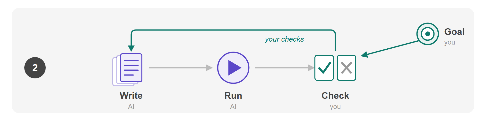
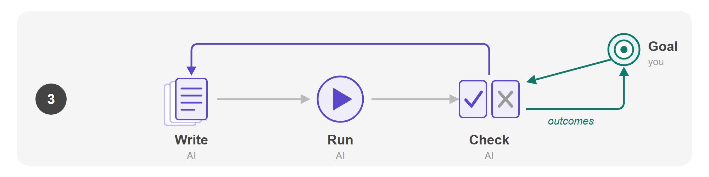

A product's **core loop** is the short cycle of steps its users repeat. Dwipal Desai, who was on
YouTube's early team, gives YouTube's as "Create > Upload > Share". Google's Playground, which his
group launched in October 2026 to make games from descriptions, has "Create > Play > Share".

Work done with AI has a core loop too: **Write > Run > Check**. A person writes down the steps, the
AI runs them, and the person checks what comes back. The loop stays the same while the AI takes
over its steps one at a time: first the running, then the writing, and now the checking. This post
follows a person's **taste**, their sense of what a good result is, through each handover, and then
asks what happens when there are more tasks than anyone's taste can reach. Its example is a wine
that has to taste the same every year, though its grapes never do.

<!-- more -->

## In the first loop, you write the blend and taste it

Most wine changes from year to year, because the grapes do. A hot summer gives riper, sweeter
grapes and a cool one gives sharper grapes, so a bottle with a year on its label tastes partly of
that year's weather.

Some wines are made not to change. The best known is champagne, the sparkling wine from the
Champagne region of northern France. Most champagne carries no year on its label, and the region's
trade body calls this non-vintage wine "the most common Champagne"
([Comité Champagne](https://www.champagne.fr/en/champagne-frequently-asked-questions)). It is the
bottle each producer, called a house, is known by, and it is meant to taste the same whenever it is
opened. The aim, in the trade body's words, is that "the style and character of a Champagne House"
endure, whatever the harvest was like
([Comité Champagne](https://www.champagne.fr/en/champagne-tasting/type-of-champagne/non-vintage-brut)).
To manage it, a house mixes the year's wine with **reserve wines**, kept back from earlier years, so
that a thin year can lean on fuller ones. Krug's current bottle is "a blend of 150 wines from 13
different years" ([Krug](https://www.krug.com/en-us/champagne/krug-grande-cuvee-173eme-edition)).

The person who keeps the style is the **cellar master**, the house's head winemaker. Each winter
after the harvest they write the blend: which wines go in, from which villages and which years, and
how much of each. It is slow work. At Krug, for six months after the harvest, the tasters meet at 11
every morning, taste no more than 15 wines a day without knowing which is which, and write around
5,000 tasting notes a year ([Krug](https://www.krug.com/en-us/craftsmanship/the-art-of-blending)).
The cellar then makes the wine. The blend is bottled with yeast and a little sugar, ferments a second
time to make its bubbles, and ages for at least 15 months before it can be sold
([AOC rules](https://www.champagne.fr/system/files/2024-03/Cahier_des_charges_appellation.pdf)). The
cellar master decides when it is ready
([Union des Maisons de Champagne](https://maisons-champagne.com/en/houses/the-champagne-houses/10-major-trades-in-champagne/article/cellar-master)).

The blend can't be written once and reused. Every harvest is different, so the proportions that held
the house style last year will miss it this year. Krug's cellar master, Julie Cavil, says "there is
no recipe, each year is a blank slate"
([Wine Advocate](https://winejournal.robertparker.com/meet-julie-cavil-krug-s-new-cellar-master)).
So every winter the cellar master writes the blend again.

Their taste goes into both of their steps, and does a different job in each. When they write the
blend, the wines in front of them are young, still and sharp, more than a year away from the wine
that will be sold. The houses' own trade body says the skill "lies in predicting the results of
second fermentation and cellaring", which it calls "a leap into the future that calls for long
experience of wine tasting" (Union des Maisons de Champagne). Writing the blend, then, uses taste to
predict a result that doesn't exist yet. Judging the finished wine uses it on the result itself.

Taste here means more than liking. David Hume's 1757 essay on the standard of taste retells a story
from *Don Quixote*. Two of Sancho's kinsmen are asked to judge a hogshead, a large barrel, of wine.
One finds "a small taste of leather" in it and the other "a taste of iron", and the people around
them laugh at both, until "on emptying the hogshead, there was found at the bottom, an old key with a
leathern thong tied to it" ([Hume](https://davidhume.org/texts/empl1/st)). Hume's point is that
taste can be fine enough to catch what others miss, and that it can be shown to be right.

AI work in the first loop has the same parts. Most AI tools for work are **harnesses**: software that
runs a model and gives it tools, data and instructions, such as Claude Code or GitHub Copilot. A
person writes the steps down, as a workflow, as a skill the model loads when a task calls for it, or
as a file of standing instructions. Those steps are the blend. The harness runs them, as the cellar
makes the wine, and the person checks what comes back, as the cellar master tastes. The tasks are
the harvest. A skill is written for the tasks the person has seen so far, as a blend is written for
the wines in the cellar, and when the tasks change, with new kinds of documents, customers or
questions, steps that worked last month start to miss.

Unlike a cellar, a harness has no blending season. When the person fixes a bad result by hand, the
steps stay as they were, and they improve only when someone sets aside time to rewrite them, a
separate job from checking.

In the figure, the person's parts are teal and the AI's are violet. **Write** and **Check** are both
yours. The **Goal** at the top right is the house style, the standard the checking is against. The
dashed arrow back to Write is the rewrite, which happens only when someone makes time for it.

## In the second loop, the AI writes the blend and your tasting steers it

In 2019 the Swedish distillery Mackmyra released a whisky whose recipe a model proposed. Built with
Microsoft and the Finnish AI firm Fourkind, the model was fed the distillery's existing recipes,
sales data and customer preferences, and could generate "more than 70 million recipes that it
predicts will be popular"
([Microsoft](https://news.microsoft.com/europe/features/meet-the-worlds-first-ai-created-whisky/)).
Mackmyra's master blender, Angela D'Orazio, then did what the model couldn't. At the end of each
round she "singled out ingredients that would work well together and corrected combinations that
she knew wouldn't work", and her corrections shaped the next round
([GeekWire](https://www.geekwire.com/2019/microsoft-got-creation-worlds-first-whisky-formulated-ai/)).
From a final shortlist of five she chose Recipe No. 36
([Microsoft](https://news.microsoft.com/europe/features/the-story-behind-the-worlds-first-ai-created-whisky/)).
Her own summary was "AI-generated, but human-curated. Ultimately, the decision is made by a person."

A cellar master searches too, by hand. Moët & Chandon's cellar master, Benoît Gouez, has described
starting each year from 800 to 1,000 base wines, building 40 to 60 trial blends, and combining 10 to
15 of those into the final blend, so as to "progressively reduce the possibilities" to "a human
scale" ([VinoVonk](https://vinovonk.com/en/sparks/benoit-gouez-moet-chandon/)). The model's 70
million recipes are the same search without the human scale.

What stayed human at Mackmyra was the judging: D'Orazio no longer wrote the recipe, but her
corrections steered each next round. She corrected recipes rather than finished whisky, which takes
years to age, so she used the predicting kind of taste a cellar master uses on young wine. AI work
has it easier here, because it is fast. A cellar master waits at least 15 months to find out what a
blend became, while a harness returns a result in minutes, so the person can judge real results
instead of predicting them.

AI work makes the same move with a test. Jerry Liu, chief executive of LlamaIndex, wrote on 9
October 2026 that "you can pretty much solve any task by defining an eval and hillclimbing over it",
rather than by writing the workflow yourself
([Liu](https://x.com/jerryjliu0/status/2108436834418373099)). An **eval** is a test: a goal plus a
way to score an attempt against it. **Hill-climbing** means trying a version, scoring it, changing
one thing, and keeping the change if the score goes up. In the second loop the AI writes the steps
this way: it tries versions on past cases and keeps the one that scores best.

Liu's wording puts the eval first: define the test, then let the AI search.
[Researchers](https://arxiv.org/abs/2404.12272) who studied people building graders for AI output
found why writing the test first fails, and named the problem *criteria drift*: "users need criteria
to grade outputs, but grading outputs helps users define criteria". People find out what they want
by looking at results. So the second loop begins at Check. The person
marks a set of past results right or wrong, with a line on why, and the marks become the eval.

Producing patterns from cases, Hume wrote, "is like finding the key with the leathern thong": it
shows a taste is right to people who couldn't taste the difference themselves. A marked result does
that for the search. The search has no taste of its own, but it can check each new version against
the cases the person marked and see whether it repeats a mistake they caught. It gets a thinner
version of the taste than an apprentice does, a few dozen marked cases rather than 13 years at the
tasting table, and it knows only what was marked.

So the person's taste now enters at one step, Check, and reaches Write through the eval. A fix to one
result becomes a case that every later search has to pass, so the way back to Write runs each time
someone checks, instead of waiting for someone to rewrite the steps.

In the figure, **Write** has turned violet, with earlier drafts behind the page for the versions the
search tried and dropped. The arrow back from **Check** is solid now, and still teal: your checks.

## In the third loop, the AI checks too, and your taste moves to the goal

Checking is now being automated the way writing was. On 28 September 2026 Anthropic shipped a
command that builds an eval, alongside one that hill-climbs against it
([Martin](https://claude.dev/blog/automating-eval-design-and-hillclimbing/)). The AI drafts the test
cases, from the work's own past transcripts where it can, writes a grader to score results, and asks
the person to approve both. That approval is the step between the second loop and the third. Once
the grader is trusted, the AI checks each result against it, and the person no longer looks at
results one by one.

Wine is heading the same way. Researchers have trained a model to predict how a Pinot Noir will
taste, its "sensory profile", from a scan of the wine in near-infrared light, with the stated aim "to
maintain a determined wine style" ([Fuentes et al.](https://www.mdpi.com/1424-8220/20/13/3618)). A
check like that could tell a cellar whether this year's blend matches the house style without anyone
tasting it. Then all three steps would be the machine's.

The loop still checks against something: a standard of what a good result is, which for the house
is its style. A cellar master's goal was always wider than any one check. Gouez again: "In a given
year, we never do the best blend – we do the best blend without compromising the future"
([The Buyer](https://www.the-buyer.net/people/producer/benoit-gouez-on-the-tricky-decisions-behind-blending-moet-imperial)).
A blend that tastes best this year might use up reserve wines that later years need, and no check
on this year's glass would show it. The person in the third loop has a problem of the same kind.
They can't learn whether the standard is right by looking at results, because the check has already
approved them. What can tell them is **outcomes**: what happened after a result left the loop. For a
wine house, that is whether people keep buying the wine and what the critics say. For AI work, it is
what the result led to.

Antaripa Saha and Hamel Husain ran six automated error-analysis tools over the logged conversations
of an apartment-leasing agent, which a domain expert had already labelled by hand
([Saha and Husain](https://parlance-labs.com/blog/posts/auto-evals.html)). The best tool found 87%
of the expert's failures, and every tool missed the same kind: conversations that "looked correct"
but fell short of what the product was for, such as the agent giving up at a prospect's first
objection. The authors saw that objection handling mattered only "after reading a trace where a
prospect walked away." The prospect walking away is an outcome. No check inside the loop caught it,
because nothing in the standard asked about it.

Sometimes the world outside the cellar changes under the style itself. Over thirty years, the Comité
Champagne reported in 2019, the harvest has begun "an average of 18 days earlier", with riper and
less acidic grapes
([SevenFifty Daily](https://daily.sevenfifty.com/how-champagne-producers-are-preserving-acidity-as-the-climate-changes/)).
Louis Roederer's cellar master, Jean-Baptiste Lécaillon, expects that "in the future, we will be
fighting for freshness instead of ripeness". The house has replaced its non-vintage with a wine
whose consistency "from one edition to the next is no longer integral", as the wine writer Essi
Avellan puts it
([Club Oenologique](https://cluboenologique.com/report/non-vintage-champagne-blending-style-changes/)).
A machine that predicts a wine's sensory profile can say whether this year's wine matches the style.
It can't say whether to keep the style or let it move with the grapes, because that is a decision
about the profile itself. Only a person can make that call, and in the third loop it is the work
left for the cellar master's taste.

In AI work, someone has to own that decision too. A drafted standard can say whether a result meets
it, but not whether it is still the right standard. If nobody owns the goal, nobody asks, and nobody
notices, because every result passes.

In the figure, everything inside the loop is violet. The **Goal** is still teal, and a new teal
arrow leads to it from outside the loop: **outcomes**.

## With hundreds of tasks, the AI sets the goals too, and taste is industrialised

So far, each loop has had one person's taste behind it, the way a house has one cellar master. Many
businesses won't have that. Say a business runs 300 support workflows through AI: refunds, delivery
questions, account changes and so on. Nobody there can hold a sense of what a good answer is for
each one, so the AI has to set the goals as well, and it can only set them from data. In wine, a
company already sets goals that way.

Tastry, in California, analyses each wine's chemistry in its lab, more than 100,000 chemical signals
per wine, and runs blind panels in which drinkers score wines without knowing which is which. From
the two, it trained what it calls "the first model to link the chemistry of a wine to the score a
population of consumers would give it", and it reports that the predicted scores match the real ones
93% of the time ([Tastry](https://tastry.com/wine)). Tastry aims that one model at three kinds of
target.

The first is a winery's own style. A Napa Valley Cabernet, 200,000 cases at $150 a bottle, needed 20%
more wine "without drifting from its signature style". Tastry turned ten vintages of it into what it
calls a style blueprint, tested every sample that bulk-wine sellers offered against the blueprint,
and found the only one that matched. The second target is a crowd: wineries use the predicted scores
to "adjust their wines to match customer tastes", as one account of the company puts it
([Forbes](https://www.forbes.com/sites/bernardmarr/2021/06/28/artificial-intelligence-can-now-tastetransforming-winemaking-with-tastry/)).
The third is one drinker. Tastry's app, BottleBird, gives each user a "palate survey" and recommends
the wines that person will like, because "consumer palates are like fingerprints – no two are
alike".

In all three, the model has no taste of its own. What it has is taste on record: a winemaker's, kept
in ten vintages; a crowd's, kept in its scores; one drinker's, kept in a quiz. That is what
industrialising taste means: recording it, so that a machine can judge wine against it without
anyone tasting. The second loop did the same on a small scale. The search there had no taste either,
only the person's, recorded as a few dozen marked cases.

With hundreds of tasks, the taste on record stops being the person's. Nobody marks cases for 300
goals, so the AI drafts the goals from records that already exist: past tickets, the ratings
customers gave, what customers did next. Those hold the customers' taste, for the crowd as a whole
or for each customer alone. So by default, the business's own taste is not what gets industrialised.
Its customers' taste is, and theirs takes the place of the business's.

In the figure, the third loop has become the front card in a stack of tasks. Its goal has turned
violet, because the AI drafts it from the **records** at the right, which hold the customers' marks,
not the person's. Nothing in the figure is teal: nothing in the stack holds the business's own
taste.

## Recorded taste repeats old judgements, and simulated taste reaches a little past them

A record of taste can repeat a judgement that someone has already made, and nothing more. For some
uses that is enough, and Hume's essay opens with a view that says why. On that view, "a thousand
different sentiments, excited by the same object, are all right": no taste is better than another,
so the only job is to match each thing with someone who likes it. BottleBird's palate survey does
that for each drinker. Tastry did it for one brand as well: it mapped where the people most likely
to love the brand's wines lived, and sales climbed "without changing the product".

Hume wrote his essay to answer that view, and the key in the barrel is his answer. Some faults are in
the wine whether anyone minds or not, and a fine enough taste finds them. A record of what drinkers
liked holds only what they noticed, and Hume thought fine taste rare: without it, "the finer touches
pass unnoticed and disregarded". So a record can't find a fault that nobody noticed, or make a
judgement that nobody has made.

A record can still make work more alike or more different, depending on whose taste it holds. A
crowd's taste pulls work together. Daniel Fleder and Kartik Hosanagar found that the recommenders
online shops use "push each person to new products, but they often push users toward the same
products" ([Fleder and Hosanagar](https://papers.ssrn.com/sol3/papers.cfm?abstract_id=955984)). Each
customer's own taste pulls work apart, as BottleBird's lists differ from one drinker to the next.

Either way, the work goes no further than the taste on record. Anil Doshi and Oliver Hauser let some
people draw on story ideas from GPT-4, a model built from a record of a great deal of what people
have written, before they wrote short stories. The ideas lifted the stories of the least creative
writers to the level of the most creative, did little for the most creative, and made the stories
more like one another ([Doshi and Hauser](https://www.science.org/doi/10.1126/sciadv.adn5290)).

Going further needs the cellar master's other job. In the first loop, taste did two things: it
judged the finished wine, and it predicted, from young, sharp wine, a wine that didn't exist yet. A
record does the judging. AI does a version of the predicting by simulating taste: building a model
of how people would respond, and asking it about things nobody has made. Mackmyra's model already
did this. Fed sales data and customer preferences, it could generate "more than 70 million recipes
that it predicts will be popular", each a whisky that didn't exist yet.

Simile now offers the same for any decision. Its founders are the Stanford researchers who created
"generative agents", AI characters built to behave like people, and its simulations "show how and
why customers, employees, or populations respond to change" ([Simile](https://www.simile.com/)). In
their research, they built agents from two-hour interviews with 1,052 Americans and gave the agents
a survey the people had taken. People don't give quite the same answers when they retake a survey
two weeks later, and the agents came 83% of the way to that level of agreement
([Park et al.](https://arxiv.org/abs/2411.10109)). A simulated customer can respond to a reply
nobody has sent, or to a product nobody has made.

Simulated taste reaches only a little past the record it is built from. James Brand, Ayelet Israeli
and Donald Ngwe, at Harvard Business School, asked language models what customers would pay for
products and features, and checked the answers against surveys of real people. The answers were
often off, and some pointed the wrong way, such as a lower price for a laptop with a bigger screen.
Training a model on earlier surveys helped it with new features of a kind of product it knew, but
not with new kinds of product
([Brand, Israeli and Ngwe](https://papers.ssrn.com/sol3/papers.cfm?abstract_id=4395751)). A
simulation can try paths close to the ones already walked, and the further a path leads from them,
the less its taste can be trusted. The authors' advice is to treat it as "a supplement to—not a
substitute for—human studies".

## Search can try every path, and finds new ones where a rule scores them

Writing a result and picking one out are separate jobs, as the second loop showed: the search wrote
versions, and the person's marked cases picked among them. The simulation's limit is in the picking.
The writing can go as far from the walked paths as anyone likes, and with enough computing it could
try every one. Liu Cixin, the author of *The Three-Body Problem*, followed that thought to its end
in *The Poetry Cloud*, a story published in 2003. A godlike being, with technology far beyond ours,
meets a human poet who tells it that classical Chinese poetry can't be surpassed. "Just for fun",
the god sets out to surpass Li Bai, the Tang dynasty's great poet. It grows a human body for itself,
dresses as Li Bai, calls for ink and wine, and can't write a line.

Two months later it comes back with what it calls the alternative route: "The two ways to surpass Li
Bai are: 1. to write poems that surpass his; 2. to write every possible poem!" It will try every
arrangement of Chinese characters in the forms Li Bai wrote in, and keep them all. The dinosaur who
brought the poet, an ambassador called Big-tooth, asks why it doesn't "install a decision-making
program at the output end to eliminate the poems that are not worth keeping". The god refuses. A
poem's meaning, it says, "is determined by time", and nobody can know which poems time will choose.
So it takes apart the Sun and the planets to store them all, in "a nebula 10 billion kilometres in
diameter that comprises all possible poems".

Big-tooth's program would have been an eval, and the ending shows what refusing it costs. Under the
cloud, the god admits defeat: "I have indeed composed the most supreme pieces of poetry by means of
our great technology, but I have been unable to locate them in the Poetry Cloud." It has tried to
write the program itself, but "a program which can appreciate ancient poetry is yet to be written"
([Liu](https://www.cuhk.edu.hk/rct/pdf/e_outputs/b7778/v7778p087.pdf)). The god's search wrote
everything and had nothing to pick with. In the second loop, the person's marked cases were the
program Big-tooth asked for.

To show the god how big its search would be, Big-tooth uses a Go board. Each of its 361 points can
be black, white or empty, so every board is a poem of 361 characters written with three, and there
are about 10 to the power of 172 of them, far more than there are atoms in the universe. Yet Go fell
to search 13 years after the story appeared, when DeepMind's AlphaGo beat a world champion in March
2016. It didn't try every board. Go holds its taste in a third form, beside a record and a
simulation: a rule. The rules say who won, so the outcome of any game is known the moment it ends,
however far its moves stray from the games people have played. AlphaGo's successor, AlphaGo Zero,
played against itself and learned from those outcomes alone, "without human data, guidance or domain
knowledge beyond game rules". Its network learned to look at a position and predict who would win,
the way a cellar master tastes young wine and predicts what it will become. That is a simulated
taste, but one built from games no person had played, and AlphaGo Zero beat AlphaGo 100 games to
none ([Silver et al.](https://www.nature.com/articles/nature24270)).

The players' taste moved too. Lee Sedol, the champion AlphaGo beat, said its moves made him wonder
whether the moves he had known were the right ones. Minkyu Shin and his colleagues studied 5.8
million moves by professional players from 1950 to 2021. After superhuman programs arrived, players
made moves nobody had made before more often, and the new moves came with better play
([Shin et al.](https://arxiv.org/abs/2303.07462)). That is the opposite of what happened to the
stories in the last section, which grew more alike when their writers drew on a model built from a
record. A record holds only the paths people have walked, while Go's rules gave its search the
outcome of paths nobody had.

Mathematics reached the same point this year. Its taste is partly a rule too: a proof holds if each
step follows from the last, and a program can check that as soon as the proof is written. In May an
OpenAI model disproved a conjecture about points in the plane that Paul Erdős made in 1946. Tim
Gowers wrote that had a human submitted the paper to the *Annals of Mathematics*, he "would have
recommended acceptance without any hesitation"
([Quanta](https://www.quantamagazine.org/why-the-legendary-erdos-problems-are-falling-to-ai-20260803/)).
As in Go, an attempt's outcome is known as soon as it exists, however far it strays from the proofs
people have found.

## Where people score the results, search stays near the record

A refund reply, a lease conversation and a new style of champagne have no rule like Go's. Nothing
says how they did except the people they reach, and people answer slowly. A prospect signs or
doesn't some time after the conversation, and a new champagne spends at least 15 months in the
cellar before anyone can drink it. Each answer costs something too, because a reply that turns out
badly has already reached a real customer. So the outcomes this kind of work can learn from are few,
and they are the ones on record.

That is the difference from Go. AlphaGo Zero's predictions could be trusted far from human games
because the rules gave it outcomes for games nobody had played. A simulated customer has only the
record to learn from, so it reaches a little past it, as Brand, Israeli and Ngwe found, and no
further. The business's own taste is in the same position at scale: its marked cases are one more
record. A search run against a record or a simulation can still write any reply, but it can pick out
only those near the replies already tried.

The last figure puts the two kinds of task side by side. Each cloud holds every result a search
could write for one task. The violet dots are the ones the AI can pick out, with its taste in
whatever form it has, and nothing is teal, as in the stack of tasks. Where the taste is **a rule**,
the AI picks results out anywhere, because every result's outcome comes free. Where it comes from
**people**, it picks them out from the **record** and the **simulated** ring around it. Beyond
those, **outcomes** reach a few results, one real trial at a time: one turned out well, and the
hollow one didn't.

For anyone building a harness, that gives each task a question to ask before its search runs: what
can say whether a result worked, and how soon? Where a rule can, such as tests that pass or totals
that reconcile, Jerry Liu's advice holds, and a search can climb far past the cases anyone marked.
Someone still has to check now and then that the rule means what they meant. Of ten results OpenAI
published in August, each with a proof a program had checked, one was still disputed four weeks
later over "whether its formalization meant what it claimed"
([Kallel and El Louadi](https://arxiv.org/abs/2608.28997)). Where only people can say, a search
against a record or a simulation stays near what has been tried, however long it runs. The way
further is to try a few new paths on real customers and add what happened to the record, so that the
next search starts from a wider patch. For the leasing agent, a new way to answer an objection can
be judged only by prospects, and by the leases they sign or don't.

Before the god leaves, it gives the poet and the dinosaur a chip each, holding the "trillions of
poems" it found in the cloud by searching for their names. It has read only a few dozen. "The good
works in the Poetry Cloud," it says, "do not yet belong to anyone." A search can write a business's
best reply, as the cloud held poems better than Li Bai's. That reply becomes the business's when
something scores it: a test, where the work has a rule, and otherwise a customer's answer.

## Sources

- Dwipal Desai, [post on LinkedIn](https://www.linkedin.com/posts/dwipaldesai_today-we-launched-something-ive-been-working-share-7513728801978187776-_O9f/), October 2026, on the launch of Playground.
- Google, [Introducing Playground: Create and play custom games](https://blog.google/innovation-and-ai/technology/ai/playground-experimental-gaming-platform/), 7 October 2026.
- Comité Champagne, [Frequently asked questions](https://www.champagne.fr/en/champagne-frequently-asked-questions) and [Non-vintage brut](https://www.champagne.fr/en/champagne-tasting/type-of-champagne/non-vintage-brut).
- Krug, [Krug Grande Cuvée 173ème Édition](https://www.krug.com/en-us/champagne/krug-grande-cuvee-173eme-edition) and [The art of blending](https://www.krug.com/en-us/craftsmanship/the-art-of-blending).
- Institut National de l'Origine et de la Qualité, [Cahier des charges de l'appellation Champagne](https://www.champagne.fr/system/files/2024-03/Cahier_des_charges_appellation.pdf).
- Union des Maisons de Champagne, [Cellar master](https://maisons-champagne.com/en/houses/the-champagne-houses/10-major-trades-in-champagne/article/cellar-master).
- David Hume, [Of the Standard of Taste](https://davidhume.org/texts/empl1/st), 1757; text from Hume Texts Online.
- Wine Advocate, [Meet Julie Cavil, Krug's new cellar master](https://winejournal.robertparker.com/meet-julie-cavil-krug-s-new-cellar-master).
- Microsoft, [Meet the world's first AI-created whisky](https://news.microsoft.com/europe/features/meet-the-worlds-first-ai-created-whisky/), 13 May 2019, and [The story behind the world's first AI-created whisky](https://news.microsoft.com/europe/features/the-story-behind-the-worlds-first-ai-created-whisky/), 2019.
- Alan Boyle, [on Mackmyra's AI-formulated whisky](https://www.geekwire.com/2019/microsoft-got-creation-worlds-first-whisky-formulated-ai/), GeekWire, 5 September 2019.
- VinoVonk, [Benoît Gouez, Moët & Chandon](https://vinovonk.com/en/sparks/benoit-gouez-moet-chandon/), 2026 (transcript of a podcast interview).
- Jerry Liu, [post on X](https://x.com/jerryjliu0/status/2108436834418373099), 9 October 2026.
- Shreya Shankar et al., [Who Validates the Validators?](https://arxiv.org/abs/2404.12272), 2024.
- Club Oenologique, [Krug chef de cave Julie Cavil on being at one with the house](https://cluboenologique.com/story/krug-chef-de-cave-julie-cavil-on-being-at-one-with-the-house/).
- Lance Martin, [Automating eval design and hillclimbing with Claude](https://claude.dev/blog/automating-eval-design-and-hillclimbing/), 28 September 2026.
- Sigfredo Fuentes et al., [Sensors 20(13):3618](https://www.mdpi.com/1424-8220/20/13/3618), 2020.
- The Buyer, [Benoît Gouez on the tricky decisions behind blending Moët Impérial](https://www.the-buyer.net/people/producer/benoit-gouez-on-the-tricky-decisions-behind-blending-moet-imperial), 2017.
- Antaripa Saha and Hamel Husain, [Do Automated Evals Work?](https://parlance-labs.com/blog/posts/auto-evals.html), 11 July 2026.
- Tina Caputo, [How Champagne producers are preserving acidity as the climate changes](https://daily.sevenfifty.com/how-champagne-producers-are-preserving-acidity-as-the-climate-changes/), SevenFifty Daily, 24 June 2019.
- Essi Avellan, [on changing non-vintage champagne styles](https://cluboenologique.com/report/non-vintage-champagne-blending-style-changes/), Club Oenologique, 9 November 2022.
- Tastry, [Wine](https://tastry.com/wine).
- Bernard Marr, [Artificial intelligence can now taste](https://www.forbes.com/sites/bernardmarr/2021/06/28/artificial-intelligence-can-now-tastetransforming-winemaking-with-tastry/), Forbes, 28 June 2021.
- Daniel Fleder and Kartik Hosanagar, [Blockbuster Culture's Next Rise or Fall: The Impact of Recommender Systems on Sales Diversity](https://papers.ssrn.com/sol3/papers.cfm?abstract_id=955984), Management Science 55(5), 2009.
- Anil Doshi and Oliver Hauser, [Generative AI enhances individual creativity but reduces the collective diversity of novel content](https://www.science.org/doi/10.1126/sciadv.adn5290), Science Advances, 2024.
- Joon Sung Park et al., [Generative Agent Simulations of 1,000 People](https://arxiv.org/abs/2411.10109), 2024, revised 2026.
- Simile, [simile.com](https://www.simile.com/).
- James Brand, Ayelet Israeli and Donald Ngwe, [Using LLMs for Market Research](https://papers.ssrn.com/sol3/papers.cfm?abstract_id=4395751), Harvard Business School Working Paper 23-062, 2023.
- Liu Cixin, [The Poetry Cloud](https://www.cuhk.edu.hk/rct/pdf/e_outputs/b7778/v7778p087.pdf), translated by Chi-yin Ip and Cheuk Wong, Renditions, 2012; first published in Chinese in 2003.
- David Silver et al., [Mastering the game of Go without human knowledge](https://www.nature.com/articles/nature24270), Nature 550, 2017.
- Minkyu Shin, Jin Kim, Bas van Opheusden and Thomas Griffiths, [Superhuman artificial intelligence can improve human decision-making by increasing novelty](https://arxiv.org/abs/2303.07462), PNAS 120(12), 2023.
- Quanta Magazine, [Why the Legendary Erdős Problems Are Falling to AI](https://www.quantamagazine.org/why-the-legendary-erdos-problems-are-falling-to-ai-20260803/), 3 August 2026.
- Maher Kallel and Mohamed El Louadi, [Verification abundance, adjudication scarcity](https://arxiv.org/abs/2608.28997), 2026.
