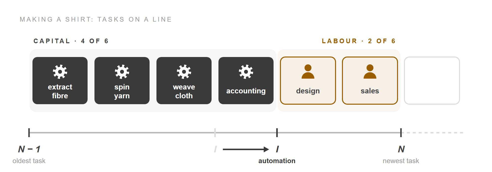

Some people see automation, from industrial robots to artificial intelligence, as the start of
widespread joblessness. Others expect it to go the way of earlier technologies and, in the end,
raise the demand for workers. Daron Acemoglu and Pascual Restrepo's 2019 paper,
[*Automation and New Tasks: How Technology Displaces and Reinstates Labor*](https://doi.org/10.1257/jep.33.2.3),
gives a way to tell which is happening, then measures it for the United States from 1947 to 2017.

This post walks through the paper's model and formulas, leaving out the proofs in its online
appendix. It starts where the paper does, with the work it takes to make a shirt.

<!-- more -->

## Tasks

The paper begins from one idea: production is a list of tasks. A shirt starts with a design.
Then fibre is extracted, spun into yarn, woven, dyed and processed, and there is work beyond the
factory floor too: accounting, marketing, transport and sales. Each task can be done by
**labour**, meaning people, or by **capital**, meaning machines and software. In the paper's
words, "Tasks are thus the fundamental unit of production, and the factors of production
contribute to output by performing these tasks."

Which factor does which task is what the paper studies. The authors call this allocation the
**task content of production**.

To make it precise, the model lines the tasks up in a row. Look at where the row splits:


Each card is a task. The tasks run from the oldest, at **N − 1**, to the newest, at **N**, so the
line always has the same length. People are relatively better at the tasks further right. Every
task left of the **threshold I** is cheaper to do with machines, so capital does it, and labour
does every task to the right. Here capital and labour do 3 of the 6 tasks each. Which side each
shirt task sits on is our illustration: the paper lists the tasks but doesn't rank them.

Two things can move on this line, and each is a kind of technology.

## Automation

**Automation** lets machines do a task that people used to do. In the model it moves the
threshold I to the right. Watch the accounting card:



Software has taken a task from people. The paper's examples include industrial robots in
factories and specialised software taking tasks from white-collar workers in accounting, sales
and logistics. Capital now does 4 tasks and labour 2.

Labour's loss of that task is the **displacement effect**. It shifts the task content of
production against labour.

## New tasks

The second kind of technology creates new tasks in which people have the advantage. In the model
it moves N to the right. Watch both ends of the line:


A new task, **market research**, appears at the right, and labour does it. The line keeps its
length, so the oldest task drops off the left end. Labour is back to 3 of the 6 tasks.

This is the **reinstatement effect**: new tasks bring labour back into a wider range of work and
shift the task content of production in labour's favour. The paper's textile examples are
"computerized designs, new methods of market research, and various managerial activities". New
tasks matter in practice. In earlier work, the authors found that about half of US employment
growth from 1980 to 2015 was in occupations whose job titles or tasks had changed.

## Task content

Counting the cards gives the model's key quantity. **Γ(I, N)**, read "gamma", is labour's share
of the tasks, which the paper calls the labour task content of production. In general it weighs
each task by how productive labour and capital are at it. In the paper's simplest case it is just
the length of the line right of the threshold:

```
Γ(I, N) = N − I
```

In the figures, Γ fell from 3/6 to 2/6 when accounting was automated, and rose back to 3/6 when
market research arrived. Automation lowers Γ and new tasks raise it. From here on, "task content
moving against labour" means Γ falling, and "in labour's favour" means Γ rising.

The paper then builds output from the tasks. The textbook production function is
Y = F(Aᴷ K, Aᴸ L): output made from effective capital and effective labour. In it, a new
technology can only make labour or capital "uniformly more productive in all tasks". The paper
keeps that shape but lets the weights on capital and labour move with I and N:

```
Y = Π(I,N) × [ Γ(I,N)^(1/σ) × (Aᴸ L)^((σ−1)/σ)  +  (1 − Γ(I,N))^(1/σ) × (Aᴷ K)^((σ−1)/σ) ]^(σ/(σ−1))
```

| Symbol | Meaning |
|---|---|
| Y | output, measured as **value added**: the value of what is made, less what was bought from other firms to make it |
| L, K | how much labour and capital is used |
| Aᴸ, Aᴷ | labour-augmenting and capital-augmenting technology: how productive people and machines are at the tasks they already do. A rise in either is a **factor-augmenting** technology |
| σ | the elasticity of substitution between tasks: how easily one task can stand in for another. If one task's relative price rises 1%, its use relative to the other falls by about σ%. It also works out to be the elasticity of substitution between capital and labour |
| Γ, 1 − Γ | labour's and capital's shares of the tasks, which act as the weights |
| Π(I, N) | total factor productivity: the gain from giving each task to the cheaper factor |

In words, output combines effective labour (Aᴸ L) and effective capital (Aᴷ K), and each one's
weight is its share of the tasks. The exponents are those of the standard constant elasticity of
substitution (CES) form; the new part is that the weights Γ and 1 − Γ move when technology moves
I or N.

## The labour share

The weights matter because they decide how income is split. The **labour share**, s<sub>L</sub>,
is the part of value added paid as wages: the wage W times labour L, divided by output Y. The
other price in the formula is R, the rental rate of capital: what it costs to use a machine for a
period. From the production function, the paper derives the formula below. Look for its two
coloured parts:


```
s_L = 1 / ( 1 + ((1 − Γ)/Γ) × ((R/Aᴷ) / (W/Aᴸ))^(1 − σ) )
```

The denominator holds two forces.

- The **task ratio**, (1 − Γ)/Γ, is capital's tasks per labour task, so it moves opposite to Γ.
  Automation raises it and new tasks lower it.
- **Relative prices** compare what a unit of work costs from each factor. Dividing R and W by
  their productivity terms gives the *effective* prices. A change in this ratio moves the labour
  share through the **substitution effect**. In the textbook model this is the only force.

The exponent, 1 − σ, sets how much prices count. When σ = 1, the price term is raised to the
power 0, which makes it 1. The denominator becomes 1 + (1 − Γ)/Γ, which is 1/Γ, so:

```
s_L = Γ
```

This is the Cobb–Douglas case, where each task's share of spending stays fixed whatever prices
do. The labour share is then just labour's share of tasks. In the shirt it fell from 50% to 33%
with automation and returned to 50% with the new task. When σ is below 1, tasks are complements:
a rise in the effective wage raises labour's share of costs, because the dearer tasks can't easily
be swapped out. Estimates put σ a little below 1, and the paper uses 0.8, so the substitution
effect is small. The paper's central result about the labour share holds for any σ: automation
lowers it and new tasks raise it.

## Three effects

The labour share says how the pie is split, but demand for labour also depends on the size of
the pie. The paper measures labour demand by the **wage bill**, the total paid to workers:

```
Wage bill = Value added × Labour share
```

A technology can change both terms. In growth rates a product becomes a sum: the percentage change
in the wage bill is the percentage change in value added plus the percentage change in the labour
share. So each kind of technology adds the same first effect, on value added, to a second effect
of its own, on the labour share:

```
Effect of automation on labour demand               = Productivity effect + Displacement effect
Effect of new tasks on labour demand                = Productivity effect + Reinstatement effect
Effect of factor-augmenting technology on labour demand = Productivity effect + Substitution effect
```

The **productivity effect** is the growth in value added. Automation creates one because firms
can use cheaper capital for tasks that people did, and the extra output raises demand for labour
in the tasks still done by people. If nothing else happened, the wage bill would grow in step
with value added. But automation also displaces, so in the paper's words, "Automation therefore
increases the size of the pie, but labor gets a smaller slice." New tasks create a productivity
effect too, because they use what people are relatively good at.

| Technology | What it moves | Labour share | Labour demand |
|---|---|---|---|
| Automation | I to the right | always falls | rises or falls |
| New tasks | N to the right | always rises | always rises |
| Factor-augmenting (Aᴸ or Aᴷ rises) | nothing on the line | changes a little | rises: always for Aᴷ, and for Aᴸ whenever σ > 1 − s<sub>L</sub> |

This table answers both sides of the opening argument. Rising productivity doesn't guarantee more
work for people, since displacement can outweigh it; the paper says "the presumption that *all*
technologies increase (aggregate) labor demand simply because they raise productivity is wrong."
Nor does automation guarantee less work, since its productivity effect can outweigh displacement.
The result depends on the sizes.

## So-so automation

The size of automation's productivity effect depends on where the gain comes from. Machines
don't get better at the tasks they already do. The gain comes from moving a task to cheaper
capital, so it is proportional to the cost saved by the move. It is small when people were
already productive at the task for what they were paid, or when the machine is only a little
cheaper.

Compare two technologies that displace the same tasks:


The **displacement** arrow is the same in both panels. Only the saving differs, and with it the
direction of **labour demand**. The arrow lengths show the idea rather than measured sizes.

The paper puts this against the popular view: "it is not the 'brilliant' automation technologies
that threaten employment and wages, but 'so-so technologies' that generate small productivity
improvements." Its example is automated customer service, which has displaced human service
representatives "but is generally deemed to be low quality and thus unlikely to have generated
large productivity gains." The authors add that some uses of artificial intelligence, on tasks
that are still hard for machines, may be so-so as well.

Because the saving depends on the wage, the setting matters too. Where labour is scarce and wages
are high, automation saves a lot and its productivity effect is strong. Where labour is plentiful
and wages are low, the same machine saves little and can reduce the demand for labour.

## Many industries

A real economy has many industries, and that adds a third channel. GDP is the value added of all
industries together, so the wage bill for the whole economy is:

```
Wage bill = GDP × Σ over industries i (labour share of i × share of value added in i)
```

If automation in one industry moves activity toward industries with higher labour shares, the
total wage bill rises even when no industry's labour share changes. This is the
**composition effect**, and it adds a term to each sum:

```
Effect of automation in i on labour demand = Productivity effect + Displacement effect + Composition effect
Effect of new tasks in i on labour demand  = Productivity effect + Reinstatement effect + Composition effect
```

US farming shows all three at once. From 1850 to 1910, horse-powered reapers and harvesters cut
agriculture's labour share from 33% to 17%, which is displacement. Meanwhile activity moved from
farms to industry, which used far more labour, a composition effect. Within industry, the labour
share rose from 47% in 1850 to 55% by 1890 as new factory jobs appeared, which is reinstatement.
Together they raised the demand for labour across the economy.

## Measuring it

So far the model runs from causes to effects. To use it on data, the authors run it backwards.
They split the change in the US wage bill, per head of population, into four parts:

```
Change in wage bill = Productivity effect + Composition effect + Substitution effect + Change in task content
```

Each part is measured or estimated from industry data:

- **Productivity effect**: the growth of GDP per head. In the data this covers every source of
  growth at once, from all technologies together.
- **Composition effect**: the shift of value added between industries, weighted by each
  industry's labour share.
- **Substitution effect**: computed from each industry's factor prices, with σ = 0.8. Turning
  observed prices into effective ones also needs the growth of Aᴸ/Aᴷ. The authors set it to the
  growth of labour productivity, 2% a year for 1947–1987 and 1.46% for 1987–2017: the rate that
  would explain labour productivity if all technical progress made labour more productive.
- **Change in task content**: what is left. For each industry,

```
Change in task content in i = % change in labour share in i − Substitution effect in i
```

In words, whatever moved an industry's labour share that relative prices can't explain is
counted as a change in which tasks labour does. The method relies on competitive markets, where
task content and relative prices are the only forces that move an industry's labour share. The
economy-wide figure adds up the industries' changes, weighted by employment.

Last, they split that change in two. They take five-year moving averages of each industry's
change in task content. Where task content moved against labour, the move counts as
displacement; where it moved in labour's favour, it counts as reinstatement. This assumes an
industry doesn't automate and add new tasks within the same five years. Where it does, the two
partly cancel, so both estimates are lower bounds.

The authors name what could break the method. Changes in employers' power to set wages, or in
firms' markups over cost, would also move labour shares, and would be miscounted as changes in
task content. They leave that for later work.

## Two eras

Measured this way, the two halves of the period look very different.

| Per head of population, per year | 1947–1987 | 1987–2017 |
|---|---|---|
| Wage bill growth | 2.5% | 1.33% |
| Productivity effect | 2.4% | 1.54% |
| Displacement | −0.48% | −0.70% |
| Reinstatement | +0.47% | +0.35% |

The rows don't sum exactly to wage-bill growth, because the small composition and substitution
effects make up the rest.

From 1947 to 1987, nearly all of the wage bill's growth was the productivity effect. There was
plenty of automation, but new tasks offset it almost exactly, so task content barely changed.

From 1987 to 2017 the wage bill grew only 1.33% a year, and it barely grew at all after 2000.
Two things changed. Productivity grew more slowly, and task content turned against labour by
0.35% a year, cutting labour demand by about 10% over the period. In manufacturing, displacement
ran at about 1.1% a year, around 30% over the period. Composition and substitution effects stayed
small in both eras. Unlike the move off the farms, the shift from manufacturing to services
brought no large composition effect, because the two have similar labour shares.

Put the two eras back on the task line. The arrow lengths are in proportion to the paper's yearly
estimates; the bars themselves are only a sketch:


In the first era, automation pushed **I** right about as fast as new tasks pushed **N** right.
In the second, **displacement** ran at twice the pace of **reinstatement**.

The authors check that the leftover really tracks automation and new tasks by comparing it with
outside measures across industries. Industries with more robots, more routine jobs in 1990, or
more use of automation technology saw task content move further against labour. Industries with
more new job titles, emerging tasks or new occupations saw it move in labour's favour. Imports of finished goods from China
show no link, as the model predicts: they change an industry's prices and size, which the
productivity and composition effects capture, but not which tasks labour does. Offshoring, which
sends labour-intensive tasks abroad, does show a link. Every relationship points the expected way, though each
explains only part of the differences between industries.

## Why it tilted

The paper closes by asking why automation sped up while new tasks slowed. It offers reasons
rather than tests. The authors think changed incentives explain the shift better than a shortage
of ideas. US tax law subsidises equipment, through tax credits and accelerated depreciation, and
taxes labour through payroll taxes. Large technology companies built their business models on
automation and small workforces. Falling government support for research may have hurt new tasks
most, because they take longer to pay off.

The same causes could help explain slow productivity growth. New tasks raise productivity, so
fewer new tasks means less of it. Slow wage growth makes automation save less. And automation
pushed by tax breaks or excessive enthusiasm tends to be the so-so kind. Their suggested policies
follow: remove incentives for excessive automation, and rebalance the direction of technological
change.

The paper's answer to the opening argument is that its evidence supports "neither the claims
that the end of human work is imminent nor the presumption that technological change will always
and everywhere be favorable to labor." What happens to work depends on the race between I and N,
and on how much each step of automation saves.

## Sources

- Daron Acemoglu and Pascual Restrepo, "Automation and New Tasks: How Technology Displaces and
  Reinstates Labor", *Journal of Economic Perspectives* 33, no. 2 (Spring 2019): 3–30.
  [doi:10.1257/jep.33.2.3](https://doi.org/10.1257/jep.33.2.3). Every number, quotation and
  formula in this post comes from this paper.
