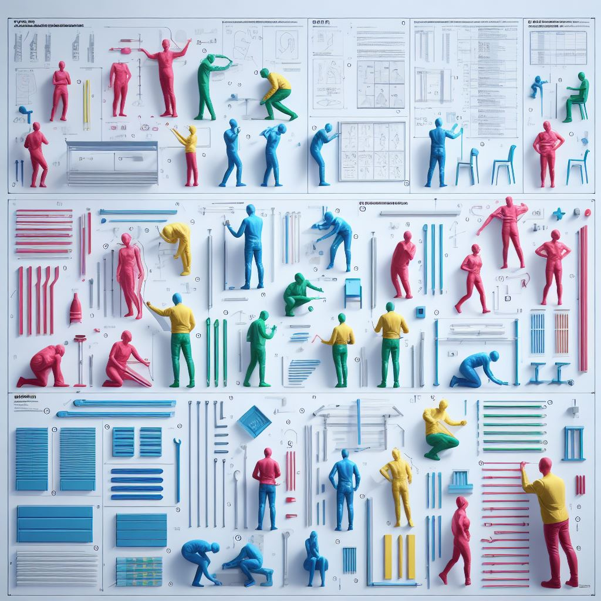

<figure markdown="span">
  { width="600" }
</figure>

<a href="about/" class="md-button">About</a>
<a href="on-writing/" class="md-button">On Writing</a>

---

-   **Recent**

    ---

    - [Concrete Is Not Control](blog/2026/11/16/concrete-is-not-control-separating-the-facility-stack-from-the-model-stack-in-australias-ai-standards/) · Nov 2026
    - [How to read the fight over AI data centres](blog/2026/11/16/how-to-read-the-fight-over-ai-data-centres/) · Nov 2026
    - [The case for open-weights models](blog/2026/10/26/the-case-for-open-weights-models/) · Oct 2026
    - [Copying what nobody can write down](blog/2026/10/26/copying-what-nobody-can-write-down/) · Oct 2026
    - [Automation and New Tasks, Explained](blog/2026/10/21/automation-and-new-tasks-explained/) · Oct 2026
    - [Outcome pricing is a piece rate](blog/2026/10/12/outcome-pricing-is-a-piece-rate/) · Oct 2026

     

    [Archive →](blog/index.md)

