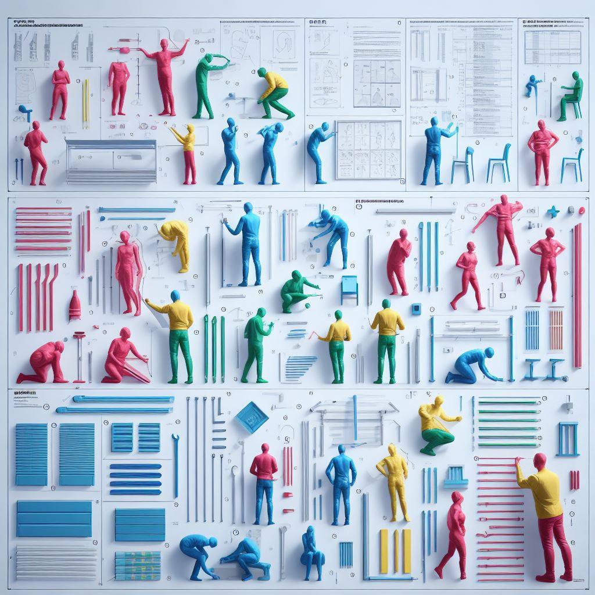

<figure markdown="span">
  { width="600" }
</figure>

<a href="about/" class="md-button">About</a>
<a href="on-writing/" class="md-button">On Writing</a>

---

-   **Recent**

    ---

    - [Copying what nobody can write down](blog/2026/10/26/copying-what-nobody-can-write-down/) · Oct 2026
    - [Automation and New Tasks, Explained](blog/2026/10/21/automation-and-new-tasks-explained/) · Oct 2026
    - [Outcome pricing is a piece rate](blog/2026/10/12/outcome-pricing-is-a-piece-rate/) · Oct 2026
    - [Write, Run, Check](blog/2026/10/12/write-run-check/) · Oct 2026
    - [Benchmarking the Harness](blog/2026/09/22/benchmarking-the-harness/) · Sep 2026
    - [The Cost Control Checklist](blog/2026/09/21/the-cost-control-checklist/) · Sep 2026

     

    [Archive →](blog/index.md)

